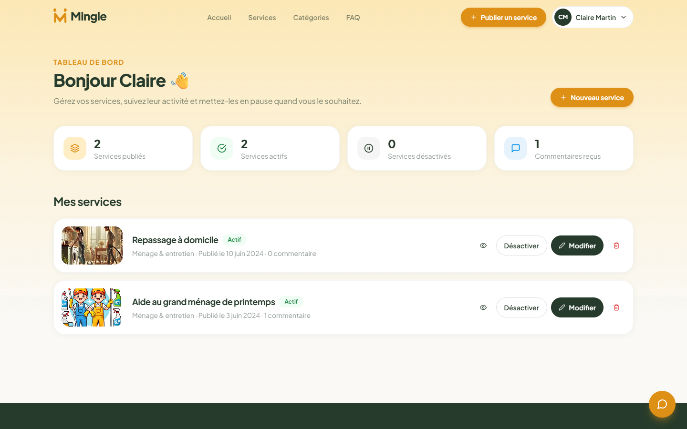
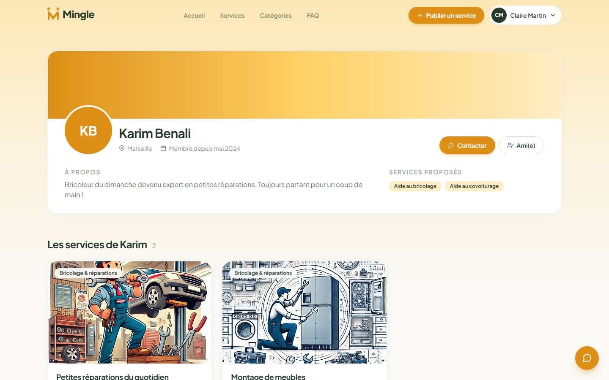
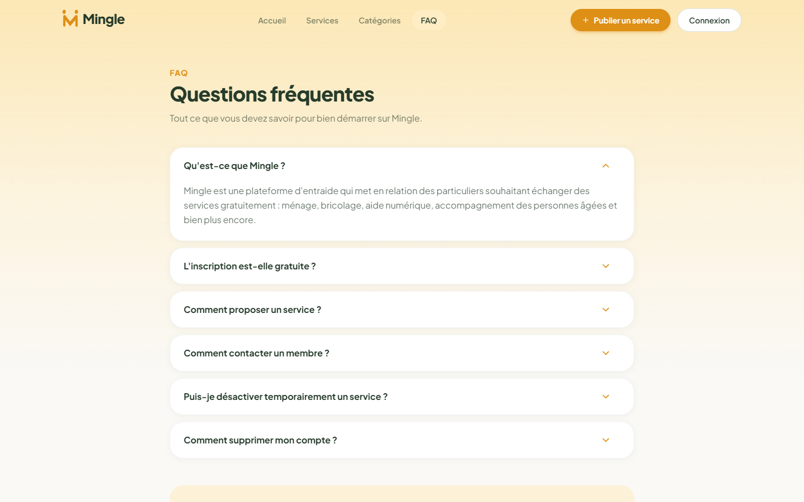

<div align="center">

# Mingle

**A community platform where neighbours exchange services for free.**
Publish what you can do, find help nearby, chat in real time. No money involved, just mutual aid.

[](https://react.dev)
[](https://vitejs.dev)
[](https://tailwindcss.com)
[](https://www.framer.com/motion/)
[](https://nodejs.org)
[](https://expressjs.com)
[](https://www.mysql.com)
[](https://www.docker.com)
[](https://jestjs.io)

</div>


## Overview

Mingle connects people who need a hand with people who have time and skills to share: cleaning, DIY repairs, digital help, keeping company with elderly people, and more. Every service is free.

> [!NOTE]
> Mingle is a project I built in 2023 during my web development training.

The project is a full-stack JavaScript application:

```
frontend/   React SPA (Vite, Tailwind CSS, Framer Motion)
backend/    REST API (Express, MySQL, JWT authentication)
```

## Features

| Feature            | Details                                                                       |
| ------------------ | ----------------------------------------------------------------------------- |
| Services           | Publish, edit, pause or delete services with an image, category and description |
| Search             | Full-text search and category filters, synced with the URL                    |
| Comments           | Members can comment on services, edit or delete their own comments            |
| Messaging          | Built-in chat widget, friends list, member search, auto-refreshing messages   |
| Profiles           | Avatar upload, biography, offered services, public profile page               |
| Dashboard          | Personal statistics and quick management of your services                     |
| Administration     | Admins manage categories and the FAQ                                          |
| Security           | Argon2 password hashing, JWT sessions, ownership checks on every write route  |
| Responsive & animated | Mobile-first layout, page transitions and scroll animations                |

## Screenshots

<table>
  <tr>
    <td></td>
    <td></td>
  </tr>
  <tr>
    <td align="center"><b>Browse services</b></td>
    <td align="center"><b>Service detail &amp; comments</b></td>
  </tr>
  <tr>
    <td></td>
    <td></td>
  </tr>
  <tr>
    <td align="center"><b>Built-in messaging</b></td>
    <td align="center"><b>Personal dashboard</b></td>
  </tr>
  <tr>
    <td></td>
    <td></td>
  </tr>
  <tr>
    <td align="center"><b>Categories (admin view)</b></td>
    <td align="center"><b>Member profile</b></td>
  </tr>
  <tr>
    <td></td>
    <td></td>
  </tr>
  <tr>
    <td align="center"><b>Sign in / Sign up</b></td>
    <td align="center"><b>FAQ</b></td>
  </tr>
</table>

<p align="center">
  
  <br />
  <b>Mobile</b>
</p>

## Demo accounts

The database script ships with demo data (members, services, comments, a conversation) and two ready-to-use accounts:

| Role  | Email                       | Password     |
| ----- | --------------------------- | ------------ |
| Admin | `admin@mingle.fr`           | `Admin123!`  |
| User  | `claire.martin@example.com` | `Mingle123!` |

The other demo members (`karim.benali`, `sophie.durand`, `lucas.petit`, all `@example.com`) also use `Mingle123!`.

> [!NOTE]
> These accounts only exist in the database you create on your own machine with `npm run migrate`. Logging in with them can only change your local copy.

> [!WARNING]
> If you deploy Mingle publicly with the demo data, change the admin password first: anyone reading this README could otherwise sign in as admin on your deployment.

## Getting started

### Requirements

- Node.js 18 or later
- Docker Desktop, **or** any MySQL 8 / MariaDB server you already have

### 1. Install

```bash
git clone https://github.com/Emmanuelle-S/Mingle.git
cd Mingle
npm install
```

`npm install` at the root also installs the `frontend` and `backend` dependencies.

### 2. Start the database

With Docker:

```bash
docker compose up -d
```

This starts MySQL 8.4 on port `3306` with the password `mingle`. The values already match `backend/.env.sample`.

Without Docker, create an empty MySQL user/database yourself and put the credentials in `backend/.env` in the next step.

### 3. Configure

```bash
cp backend/.env.sample backend/.env
cp frontend/.env.sample frontend/.env
```

Then set `JWT_SECRET` in `backend/.env` to a long random string:

```bash
node -e "console.log(require('crypto').randomBytes(48).toString('hex'))"
```

### 4. Create the tables and demo data

```bash
npm run migrate
```

> [!WARNING]
> `migrate` drops and recreates the database named in `DB_NAME`. Never point it at a database whose data you want to keep.

### 5. Run

```bash
npm run dev
```

| Service  | URL                     |
| -------- | ----------------------- |
| Frontend | http://localhost:5173   |
| API      | http://localhost:5000/api |

## Environment variables

**`backend/.env`**

| Variable         | Description                                  | Default                 |
| ---------------- | -------------------------------------------- | ----------------------- |
| `APP_PORT`       | API port                                     | `5000`                  |
| `FRONTEND_URL`   | Allowed CORS origin                          | `http://localhost:5173` |
| `DB_HOST`        | MySQL host                                   | `localhost`             |
| `DB_PORT`        | MySQL port                                   | `3306`                  |
| `DB_USER`        | MySQL user                                   | `root`                  |
| `DB_PASSWORD`    | MySQL password                               | `mingle`                |
| `DB_NAME`        | Database name                                | `mingle`                |
| `JWT_SECRET`     | Secret used to sign session tokens           | *required*              |
| `JWT_EXPIRES_IN` | Session lifetime (`7d`, `12h` or seconds)    | `7d`                    |

**`frontend/.env`**

| Variable           | Description                       | Default                 |
| ------------------ | --------------------------------- | ----------------------- |
| `VITE_BACKEND_URL` | API base URL, without `/api`      | `http://localhost:5000` |

## Project structure

```
Mingle/
├── backend/
│   ├── __tests__/              API tests (Jest + Supertest)
│   ├── public/uploads/         Uploaded images (demo images included)
│   ├── src/
│   │   ├── controllers/        Request handlers
│   │   ├── middlewares/        Auth, validation, error handling
│   │   ├── models/             Data access (one manager per table)
│   │   ├── utils/              Async wrapper, image upload
│   │   ├── app.js              Express app
│   │   └── router.js           API routes
│   ├── database.sql            Schema and demo data
│   ├── migrate.js              Recreates the database
│   └── index.js                Server entry point
├── frontend/
│   ├── __tests__/              Component and helper tests
│   ├── public/                 Favicon
│   └── src/
│       ├── assets/             Images and illustrations
│       ├── components/         UI, layout, chat, services, comments...
│       ├── contexts/           Auth and chat state
│       ├── pages/              One folder per page
│       └── services/           API client, formatting, validation helpers
├── docs/screenshots/
└── docker-compose.yml          Local MySQL for development
```

## API

All routes are prefixed with `/api`. Routes marked 🔒 require an `Authorization: Bearer <token>` header, 🛡️ also require an admin account.

| Method | Route                          | Description                                   |
| ------ | ------------------------------ | --------------------------------------------- |
| POST   | `/auth/register`               | Create an account                             |
| POST   | `/auth/login`                  | Sign in, returns a JWT                        |
| GET    | `/auth/me` 🔒                  | Current user                                  |
| GET    | `/users?search=`               | Search members                                |
| GET    | `/users/:id`                   | Public profile (email only visible to its owner) |
| PUT    | `/users/:id` 🔒                | Update your profile (multipart, `avatar`)     |
| DELETE | `/users/:id` 🔒                | Delete your account                           |
| GET    | `/services?search=&categoryId=&userId=` | List active services               |
| GET    | `/services/:id`                | Service detail                                |
| POST   | `/services` 🔒                 | Publish a service (multipart, `image`)        |
| PUT    | `/services/:id` 🔒             | Update your service                           |
| DELETE | `/services/:id` 🔒             | Delete your service                           |
| GET    | `/services/:id/comments`       | Comments of a service                         |
| POST   | `/services/:id/comments` 🔒    | Add a comment                                 |
| PUT    | `/comments/:id` 🔒             | Edit your comment                             |
| DELETE | `/comments/:id` 🔒             | Delete your comment                           |
| GET    | `/categories`                  | List categories with service counts           |
| POST · PUT · DELETE | `/categories` 🛡️  | Manage categories                             |
| GET    | `/faq`                         | List FAQ entries                              |
| POST · PUT · DELETE | `/faq` 🛡️         | Manage the FAQ                                |
| GET    | `/friends` 🔒                  | Your friends                                  |
| POST   | `/friends` 🔒                  | Add a friend `{ friend_id }`                  |
| DELETE | `/friends/:id` 🔒              | Remove a friend                               |
| GET    | `/conversations` 🔒            | Your conversations                            |
| POST   | `/conversations` 🔒            | Open or reuse a conversation `{ user_id }`    |
| DELETE | `/conversations/:id` 🔒        | Delete a conversation                         |
| GET    | `/conversations/:id/messages` 🔒 | Messages of a conversation                  |
| POST   | `/conversations/:id/messages` 🔒 | Send a message `{ content }`                |
| POST   | `/contact`                     | Send a message through the contact form       |

Errors always come back as JSON: `{ "error": "Readable message" }`.

## Scripts

Run from the project root:

| Command           | What it does                                  |
| ----------------- | --------------------------------------------- |
| `npm run dev`     | Starts the API and the frontend together      |
| `npm run migrate` | Recreates the database with demo data         |
| `npm run build`   | Builds the frontend for production            |
| `npm test`        | Runs the backend and frontend test suites     |
| `npm run lint`    | Lints both projects with ESLint               |

## Tests

```bash
npm test
```

- **Backend**: 23 API tests (Jest + Supertest) covering authentication, permissions, ownership checks, messaging, uploads and error handling. The database layer is mocked, so no MySQL server is needed.
- **Frontend**: 13 tests (Jest + Testing Library) for the 404 page, the profanity filter and the offered-services validator.
